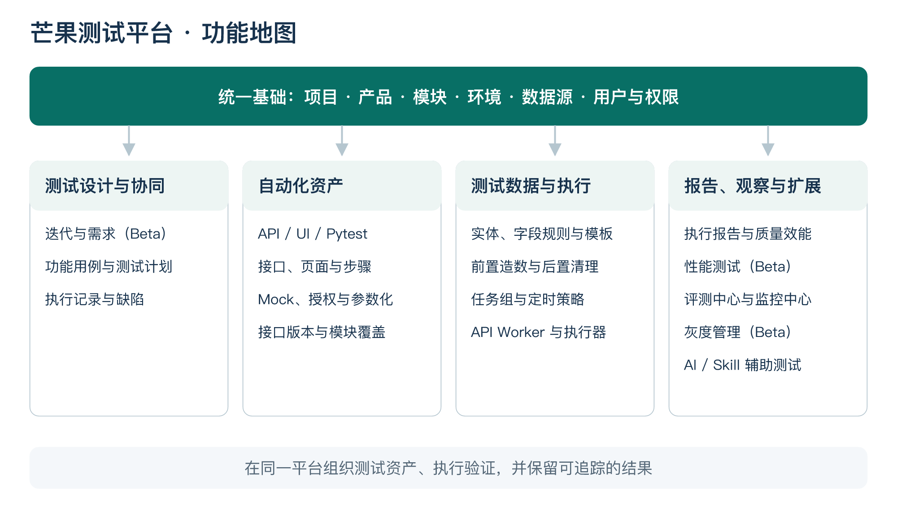
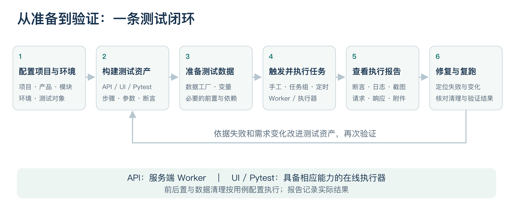
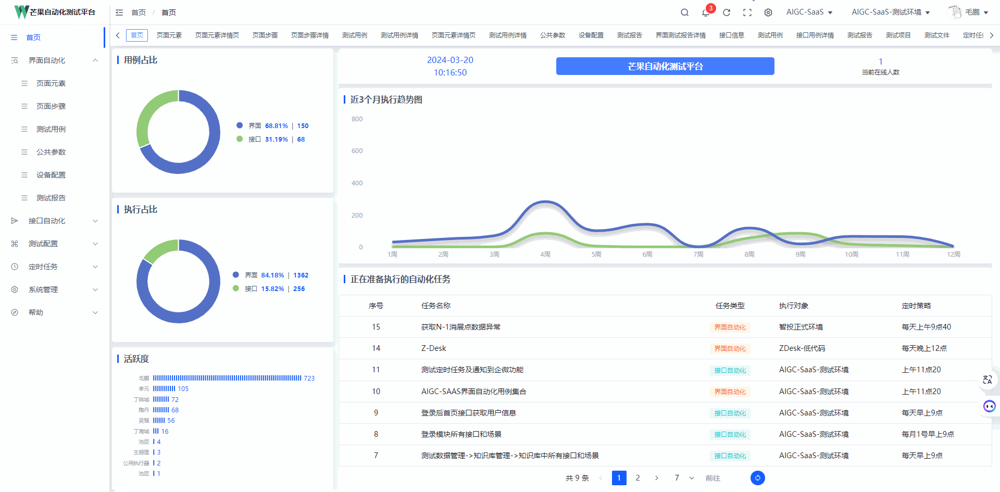
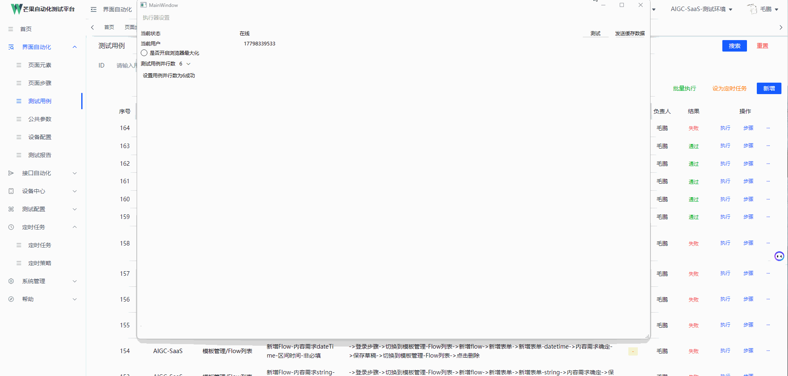

# MangoTestingPlatform · 芒果测试平台

**在同一平台管理测试设计、API / UI / Pytest 自动化、测试数据与执行结果。**

芒果测试平台是一套支持私有部署的低代码测试平台。你可以通过页面配置接口和界面用例，也可以接入已有 Pytest 项目，将测试资产组织成可持续执行、可定位问题的团队工作流。

[Gitee 仓库](https://gitee.com/mao-peng/MangoTestingPlatform) · [GitHub 仓库](https://github.com/maopengg/MangoTestingPlatform) · [在线 Demo](http://160.202.231.91:35966/#/index/home) · [帮助文档](http://160.202.231.91:36696/) · [Mango Mock 靶场](http://160.202.231.91:20017) · [执行器下载](https://www.alipan.com/s/8CmZdabwt4R)

## 先体验，再接入自己的项目

| 入口 | 可以做什么 |
| --- | --- |
| [在线 Demo：芒果测试平台](http://160.202.231.91:35966/#/index/home) | 查看当前平台界面，按演示站提示注册并体验自动化流程 |
| [帮助文档](http://160.202.231.91:36696/) | 按图文步骤完成部署、项目配置、用例创建及问题排查 |
| [Mango Mock 测试靶场](http://160.202.231.91:20017) | 为接口及页面自动化提供可练习的被测服务 |
| [MangoPytest 独立项目](https://gitee.com/mao-peng/mango_pytest) | 在本地运行 API/UI Demo，也可以将代码项目接入测试平台 |

演示环境用于学习和体验，请使用测试数据；正式项目建议私有部署。本文介绍当前仓库功能，在线 Demo 的版本和已启用模块可能与本地源码不同。

## 平台功能地图



### 主要功能

| 模块 | 用途 |
| --- | --- |
| **UI 自动化** | 管理页面、元素、定位与可复用步骤；编排操作、断言和业务流程，通过执行器运行并查看截图与日志 |
| **API 自动化** | 管理接口及版本、多步骤场景、授权、变量提取、断言、前后置、用例套件和参数化 |
| **多协议接口测试** | 覆盖 HTTP、WebSocket、SSE、MCP、gRPC 等被测接口协议；具体以所选接口类型及运行环境为准 |
| **Pytest 自动化** | 接入多个仓库和项目，配置分支、目录与产品绑定，发现用例、执行并收集结果 |
| **数据工厂** | 维护逻辑数据源、实体、字段规则与模板，为用例准备业务数据，查看变量回写和清理结果 |
| **Mock 服务** | 配置请求匹配规则及响应，查看请求记录，辅助依赖未就绪、联调和异常场景测试 |
| **模块覆盖与 AI 辅助** | 结合 Skill 与 AI 扫描源码、建设 API 自动化，维护接口清单、用例关联与覆盖进度；不做源码扫描可忽略模块覆盖 |
| **研发协同（Beta）** | 组织迭代、需求、功能用例、测试计划和缺陷，将测试活动关联到需求验证 |
| **任务调度** | 通过任务组、定时任务和触发策略组织回归，跟踪调度与执行状态 |
| **报告分析** | 查看用例与场景结果、请求响应、断言、日志、截图及附件，汇总质量与执行趋势 |
| **性能测试（Beta）** | 配置性能场景和负载，管理执行容量，观察运行指标与历史结果 |
| **评测中心** | 管理版本化数据集、评分器、评测目标与用例，查看样本结果和评分明细 |
| **监控中心** | 配置检测脚本及运行策略，持续查看检测结果与异常记录 |
| **灰度管理（Beta）** | 管理灰度仓库、配置与开关，并保留执行记录 |
| **测试配置与设备中心** | 统一项目、产品、模块、环境、测试对象和数据源，查看执行器登录状态与能力 |
| **组织权限与系统运维** | 按用户、角色、部门及项目范围控制访问，维护系统配置、运行状态、审计与异常记录 |

Beta 模块会继续迭代；实际可见菜单和可执行操作受版本、角色权限、项目范围及部署配置影响。复杂业务仍可通过 Pytest 或自定义代码扩展，不要求所有测试都使用同一种写法。

## 从准备到验证



1. **准备基础配置**：建立项目、产品与模块，选择环境并配置测试对象地址。
2. **构建测试资产**：维护 API/UI 用例，或绑定已有 Pytest 项目。
3. **按需准备数据**：使用变量、前置处理或数据工厂，配置需要的清理策略。
4. **执行并追踪**：手工执行或交给任务组、定时任务，通过 Worker/执行器完成验证。
5. **查看结果并改进**：根据报告定位失败，核对清理结果，修复后复跑。

API 任务由服务端 Worker 执行；UI、Pytest 等任务需要在线且能力匹配的执行器。前后置与数据清理按用例配置执行，不能只根据“任务已提交”判断测试通过。

## 快速部署

### 单机 Docker Compose

准备 Git、Python 3、Docker Engine 和 Docker Compose V2，在目标服务器执行：

```sh
git clone -b master https://gitee.com/mao-peng/MangoTestingPlatform.git
cd MangoTestingPlatform

# 首次生成配置，不拉取更新，也不启动服务
sh deploy.sh --prepare-only

# 编辑 .env.example，设置实际访问地址和需要的数据库、存储配置
# 确认后部署
sh deploy.sh
```

**统一用户配置入口为根目录 `.env.example`**，参数说明见 [`.env.example`](.env.example)。通常不需要修改 Compose、Nginx 或后端配置文件。

| 配置 | 支持方式 |
| --- | --- |
| 数据库 | `MYSQL_MODE=internal` 使用内置 MySQL；`external` 使用已有数据库；`settings` 沿用所选后端环境文件中的数据库配置 |
| 文件存储 | `FILE_STORAGE_BACKEND=local/minio/tos`，按需使用本地文件、内置/外部 MinIO 或火山 TOS |
| 访问地址 | 配置 `PUBLIC_URL`、端口及前端 API 地址，支持同源代理或前后端分离 |
| 执行器 | 按需要接入独立执行器，确认运行环境、依赖和登录账号 |

默认使用内置 MySQL 与本地文件存储。部署前请将 `PUBLIC_URL` 改成实际可访问的地址；默认网页端口为 `8000`，NAT 服务器还需配置对应公网转发。

首次初始化的管理员密码保存在 `.env` 的 `MANGO_INITIAL_ADMIN_PASSWORD` 中，已有用户密码不会因重新部署而自动重置。UI/Pytest 运行前，需在“设备中心 → 执行器管理”确认执行器已登录。

### 更新与其他部署方式

```sh
# 自动拉取当前分支更新，按源码变化构建并部署
sh deploy.sh

# 确实需要强制重建时使用
sh deploy.sh --build
```

脚本默认执行 `git pull --ff-only`；请保留分支的远程跟踪关系，先处理本地源码修改或分支分歧。已有配置与私有 `.env` 中的密钥会保留；后续只需修改 `.env.example`；切换数据库或对象存储并不等于自动迁移历史数据。

Compose 与 Kubernetes 读取同一份 `.env.example`。Kubernetes 需要提前准备集群、镜像及持久化资源，详细步骤见[统一部署说明](deploy/README.md)。源码构建前端需要足够的主机内存，低配服务器可先在其他环境构建镜像。

> **历史用户升级前务必备份。** 近期数据模型和功能结构变化较多，请先备份 `.env`、数据库、附件及重要运行数据，核对新旧版本并自行完成必要的数据迁移。部署脚本执行已有迁移，不代表任意旧版本都能直接兼容升级。

部署、Windows/macOS 开发启动、操作截图和错误排查统一查阅[帮助文档](http://160.202.231.91:36696/)。

## 功能演示

以下为保留的历史动图，用于了解产品操作方式；当前菜单与界面以实际版本为准。

### 平台功能演示



### UI 自动化执行与报告



### API 自动化执行与报告


## 项目与文档结构

```text
MangoServer/                后端 API、任务调度、API Worker 与平台业务服务
MangoActuator/              UI、Pytest 等任务的独立执行器
mango-console/             Web 控制台
deploy/                   统一部署脚本、配置模板与操作说明
docs/assets/readme/       README 使用的动图、二维码及功能/流程图
```

图片统一存放在 [`docs/assets/readme/`](docs/assets/readme/)：`demos/` 为演示动图，`contact/` 为联系二维码，`diagrams/` 为功能与流程图，根目录不再散放这些素材。

## 开源协议与作者诉求

### 许可证

仓库使用 [GNU AGPL-3.0](LICENSE)。修改、分发或通过网络提供修改版服务时，请阅读并遵守完整许可证，保留适用的版权与许可声明，并履行相应的源码提供义务。

AGPL-3.0 并不是“禁止商业用途”的许可证，收费分发也需要遵守其条件，参见 [GNU 官方说明](https://www.gnu.org/licenses/gpl-faq.en.html#DoesTheGPLAllowMoney)。

### 作者的开源诉求

- 希望项目用于**企业内部测试建设、学习和技术交流**，帮助更多人把自动化真正用起来。
- **不希望项目被用于收费教学、二次销售等以项目本身牟利的活动。**
- 二次开发请尊重原作者，保留项目名称、作者署名、原始版权、许可证以及 README 中的联系方式。
- 请保留前端与执行器中的作者帮助文档入口，不要将原项目包装为完全独立原创的产品。
- 欢迎反馈问题、分享实践和提交改进；功能安排与回复速度会结合维护精力和项目方向决定。

以上为作者对项目使用和社区协作的倡议，与许可证条文本身分开说明；授权及义务以完整许可证和适用约定为准。

## 联系作者与参与贡献

- **作者微信**：`mpeng0813`，添加时备注 **“芒果测试平台”**。
- **联系邮箱**：[729164035@qq.com](mailto:729164035@qq.com)。
- **问题与建议**：[Gitee 仓库](https://gitee.com/mao-peng/MangoTestingPlatform) / [GitHub 仓库](https://github.com/maopengg/MangoTestingPlatform)。

| 作者微信 | 测试交流群 |
| --- | --- |
|  |  |

群二维码失效时，可以添加作者后申请邀请。反馈问题请提供版本、部署方式、复现步骤、预期与实际结果，并附上脱敏截图或日志；请勿提交密码、访问令牌及真实业务数据。

如果项目对你有帮助，欢迎 **Star、提交 Issue、完善文档或贡献代码**。愿意请作者喝杯咖啡的话，可使用下图右侧的微信收款码；支持完全自愿。


---

版权所有 © 2022–至今 芒果味。感谢每一位使用、反馈和参与建设的朋友。
