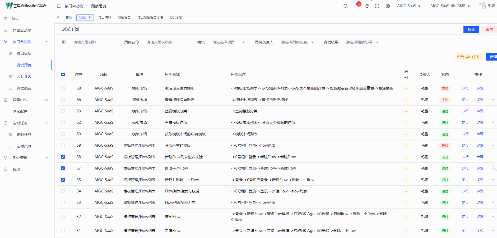

# MangoTestingPlatform · 芒果测试平台

> 让测试资产、测试数据和自动执行真正连成一条线。

芒果测试平台是一套开源、可私有部署的低代码测试平台。它将 API、UI 和 Pytest 自动化，以及环境配置、测试数据、任务调度、远程执行和测试报告放进同一条可追踪链路，适合希望把个人脚本沉淀为团队质量资产的测试团队。

[Gitee](https://gitee.com/mao-peng/MangoTestingPlatform) · [GitHub](https://github.com/maopengg/MangoTestingPlatform) · [在线演示](http://160.202.231.91:35966/) · [帮助文档](http://160.202.231.91:36696/) · [执行器下载](https://www.alipan.com/s/8CmZdabwt4R)

## 一键部署到单台服务器

安装 Docker、Docker Compose 插件、Git 和 Python 3 后，在仓库根目录执行：

```sh
sh deploy.sh
```

默认启动 MySQL、前后端、网关和后台任务服务，使用持久化的本地文件存储，不依赖 MinIO 镜像。
首次自动生成私有 `.env`；默认入口为 `http://服务器地址:8000`，NAT 服务器需要配置端口映射。
初始管理员账号为 `admin`，密码保存在服务器 `.env` 中。配置、升级、备份与排错见
[单机部署说明](deploy/README.md)。

## 为什么使用芒果测试平台

- **统一管理测试资产**：按项目、产品、模块和环境组织 API、UI 与 Pytest 用例。
- **把测试数据纳入执行闭环**：执行前自动造数，执行中引用结果，结束后按策略清理。
- **让执行过程可追踪**：保留请求、响应、断言、日志、截图、状态和历史报告。
- **兼顾低代码与代码资产**：常规场景通过页面配置，已有 Pytest 项目也可以统一接入。
- **连接 AI 与真实平台能力**：通过 MCP 查询测试资产、执行任务和报告，而不只生成孤立脚本。

## 核心能力

| 能力 | 主要内容 |
| --- | --- |
| API 自动化 | 接口与多步骤用例管理、场景参数、变量提取、断言、前后置 SQL/函数、重试与报告 |
| UI 自动化 | Web、Android、PC 桌面场景，页面元素、步骤编排、录制、远程执行与失败截图 |
| Pytest 自动化 | 测试项目、文件和用例管理，用例发现、执行调度、结果收集与报告 |
| 测试数据工厂 | 逻辑数据源、环境绑定、业务实体、字段规则、状态模板、造数与清理 |
| 调度与执行 | 测试套件、定时任务、API Worker、独立执行器、WebSocket 状态与日志回传 |
| 报告与监控 | 执行汇总、步骤明细、请求响应、断言结果、失败信息、日志与截图 |
| MCP / AI | 以结构化工具开放项目上下文、测试资产、执行任务和报告查询能力 |

复杂场景仍可能需要编写 Pytest、自定义函数或扩展执行器；平台不以“零代码替代一切”为目标。

## 最新版能力预告

最新版正在把平台从自动化执行继续扩展到完整的研发质量闭环，已经建设研发协同、性能测试、API 模块覆盖与 Mock、UI 智能定位与自愈、质量效能、灰度管理、统一 SQL 审计和多端异常中心等能力。

这些能力会按版本逐步开放，公开仓库当前代码不一定已经包含全部功能。详情见[芒果测试平台 7.1.1 最新能力预告](docs/promotion/release-7.1.1.md)。

## 一条典型执行链路

```text
配置项目与测试环境
        ↓
维护 API / UI / Pytest 测试资产
        ↓
按业务状态准备测试数据
        ↓
手工或定时触发任务
        ↓
Worker / 执行器运行测试
        ↓
收集请求、响应、断言、日志和截图
        ↓
生成报告并按策略清理测试数据
```

## 功能演示

下列动图来自历史版本，用于快速了解产品形态；界面和菜单以当前版本为准。

### 平台概览


### UI 自动化执行与报告


### API 自动化执行与报告



## 项目结构

```text
MangoServer/       Django REST 后端、任务服务、API Worker 与 MCP Service
MangoActuator/     UI、Pytest 等任务的桌面/远程执行器
mango-console/     Vue 3 + TypeScript Web 控制台
```

常见部署拓扑包括 Web 控制台、Core API、Scheduler、API Worker、MCP Service、MySQL、Redis、MinIO 和按需部署的执行器。具体依赖和配置以帮助文档为准。

## 开始使用

1. 先查看[帮助文档](http://160.202.231.91:36696/)，了解部署依赖和初始化流程。
2. 按[Docker 部署教程](http://160.202.231.91:36696/pages/%E9%83%A8%E7%BD%B2%E6%95%99%E7%A8%8B/docker.html)部署平台服务。
3. 需要运行 UI 或 Pytest 任务时，下载并配置[执行器](https://www.alipan.com/s/8CmZdabwt4R)。
4. 也可以先访问[在线演示](http://160.202.231.91:35966/)；请按演示站提示注册和使用，不要录入真实业务数据或凭据。

遇到问题时，建议在 Gitee 或 GitHub 提交 Issue，并附上平台版本、部署方式、复现步骤和脱敏后的错误日志。请勿提交密码、Token、Authorization、真实业务域名或生产数据。

## 许可证与使用边界

项目遵循 [AGPL-3.0](LICENSE) 开源协议，可用于企业内部自动化建设、学习和技术交流。二次开发、部署和分发须遵守许可证及项目版权声明；不支持将本项目用于收费教学、二次销售等盈利活动，也不得移除项目名称、作者署名、许可证和 README 中的作者联系方式。

版本号以代码中的服务端、前端和执行器配置为准，发布或升级时请确保三端版本匹配。

## 支持与交流

添加作者微信时请备注 `git芒果测试平台`，也可以加入测试交流群。二维码只用于项目交流，请勿用于广告或无关推广。

| 作者微信 | 测试交流群 |
| --- | --- |
|  |  |

如果项目对你有帮助，欢迎 Star、提交 Issue，或分享真实使用场景。具体而可复现的反馈最有价值。
